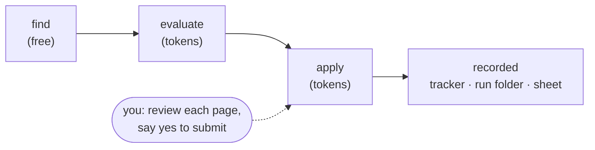

# job-hunter

Find jobs, score them against your CV, and fill applications in your own
browser, one page at a time. You review every page and say "yes" before
anything is submitted. Built on [career-ops](https://github.com/career-ops-hq/career-ops)
(the "engine", in `engine/`: scanning, scoring, tracker), with a simpler layer on top.

## The loop

```
./jobs find       scan company job boards → my-data/runs/<date>/jobs-found.md
./jobs evaluate   score each new job (0-5) → scores.md + reports/
./jobs apply      fill applications for jobs scoring ≥ 4.0, page by page
                  (--unscored: skip evaluate, quick check per job instead)
./jobs status     what's found / scored / applied / waiting
```

Every submitted application is ticked in its run folder, recorded in the
tracker, and (optional) added to a Google Sheet.

## How it works



1. **find** scans your companies' job boards and lists new jobs.
2. **evaluate** has Claude score each job against your CV.
3. **apply** fills forms for jobs scoring at least 4.0 while you watch each page.
4. Each submit is **recorded** in the tracker, the run folder and your sheet.

Full flow, every script, and where each file lives: [workflows/README.md](workflows/README.md).

## Output of each step

All output goes to `my-data/`. Each scan gets its own folder, `runs/DATE/`
(for example `runs/2026-11-24_0800/`).

### `./jobs find` → `runs/DATE/jobs-found.md`

One line per new job. The checkbox shows where it stands:

```
- [ ] Coinbase — Software Engineer | Remote - USA | posted 2026-10-20 | yrs 2+ | <url>
```

`[ ]` open · `[x]` applied · `[!]` skipped. `yrs` is the minimum experience
the posting states, if any.

### `./jobs evaluate` → `reports/`, `scores.md`, `tracker.md`

**`runs/DATE/reports/047-coinbase-2026-11-23.md`**, one report per job:

```
# Evaluation: Coinbase — Software Engineer - Crypto Data Foundations
**Score:** 4.2/5      **Decision:** Apply      **Legitimacy:** High Confidence
**Work Auth:** ⚠️ Unstated      **URL:** <url>
## A) Role Summary      ## B) Match with CV (+ gaps)    ## C) Level and Strategy
## D) Comp and Demand   ## E) Customization Plan        ## F) Interview Plan
## G) Posting Legitimacy   ## Verdict   ## Risk Summary   ## Job Description (archived)
```

**`runs/DATE/scores.md`**: that run's jobs, highest score first.
**`tracker.md`**: every job you've ever evaluated. Both use the same table:

```
| # | Date | Company | Role | Score | Status | PDF | Report | Notes |
| 47 | 2026-11-23 | Coinbase | Software Engineer - Crypto Data Foundations | 4.2/5 | Evaluated | ❌ | 047 | Remote US; 2+ yrs; $152K-$179K; … |
```

The job's line in `jobs-found.md` also gains its score: `… | score 4.2 | <url>`.

### `./jobs apply` → filled form, then records

Nothing is written until you say **yes** and the confirmation page appears. Then:

| Where | Change |
|---|---|
| `tracker.md` | Status → `Applied` |
| `runs/DATE/jobs-found.md` | `- [x] … — applied 2026-11-24` (skipped: `- [!] … — skipped: <reason>`) |
| Google Sheet | new row: `Company · Date · Role · Location · Link · Referral? · Result` |
| `profile/form-answers.yml`, `preferences/house-rules.md` | answers and rules learned from your edits |

Tracker statuses: `Evaluated` → `Applied` → `Responded` / `Interview` →
`Offer` / `Rejected`, plus `SKIP` and `Discarded`.

### `./jobs status` → summary on screen

```
Tracker: 43 jobs  ·  Evaluated 31  ·  SKIP 1  ·  Applied 11
Runs (newest first):
  2026-11-23_1716  30 found · 8 applied · 4 skipped · 0 ready (score ≥ 4) · 0 not yet scored
```

### Daily schedule (optional) → `shortlist.md`

A quick title-and-location triage of new jobs, with no posting opened:
`## Worth a look` · `## Maybe` · `## Skip`, one line per job with a reason.

## What's free and what uses tokens

"Free" means plain scripts on your machine: no AI model, nothing billed.
"Tokens" means Claude does the work, which counts against your Claude plan or API usage.

| Step | Cost | What runs |
|---|---|---|
| `./jobs setup` | Free | copies templates, installs dependencies |
| `./jobs onboard` | **Tokens** (once) | Claude asks about you and writes your CV/profile |
| `./jobs find` | Free | calls companies' public job-board APIs (Greenhouse, Ashby, Lever, …), filters by title, location, age and years |
| `./jobs evaluate` | **Tokens** (per job) | Claude reads each posting and scores it against your CV |
| `./jobs apply` | **Tokens** (per application) | Claude fills the form in your Chrome, page by page |
| `./jobs status` | Free | reads your tracker and run folders |
| `./jobs sheet` / `sheet push` | Free | builds sheet rows and sends them to your Apps Script |
| `./jobs doctor` | Free | checks links and setup |
| `./jobs schedule install` (daily) | Free scan + **small** token use | `find`, then a short title-only triage by Claude into `shortlist.md` |

To keep token use down, run `find` as often as you like (it's free), then
`evaluate` only what looks worth it. Scores below `apply.min_score` (default
4.0) never reach `apply`.

**Skipping evaluate:** `./jobs apply --unscored` works through jobs that were
never scored. Before each one it shows a quick check (title, location, stated
years, sponsorship line, one-line fit) and fills the form only after you say
ok. No report is written; the tracker row gets score `N/A`.

## Choosing what to scan

**Which companies:** `my-data/preferences/target-companies.yml`, under
`tracked_companies:`. Each entry is one company's job board:

```yaml
  - name: Stripe
    careers_url: https://job-boards.greenhouse.io/stripe
    api: https://boards-api.greenhouse.io/v1/boards/stripe/jobs
    enabled: true        # false = skip it without deleting it
```

The same file also sets which titles count (`title_filter`), where
(`location_filter`) and how old a posting may be (`max_posting_age_days`).
Experience is set in `my-data/preferences/settings.yml` (`find.max_required_years`).
Or just ask Claude: "add Figma", "turn off Salesforce", "only the last 14 days".

`search_queries:` in that file are web searches for companies *not* on your
list. They're used only by `/career-ops scan` inside Claude (tokens), not by
the free `./jobs find`.

**Which dates, for one scan:**

```bash
./jobs find --since 7                                   # posted in the last 7 days
./jobs find --posted-after 2026-11-01                   # posted after a date
./jobs find --posted-after 2026-10-01 --posted-before 2026-11-30
./jobs find --company Stripe                            # one company
./jobs find --dry-run                                   # preview, save nothing
```

## Setup (about 10 minutes)

Needs: Node.js 20+, [Claude Code](https://claude.com/claude-code), and the
[Claude in Chrome](https://claude.ai/chrome) extension for applying.

```bash
git clone <this repo> job-hunter && cd job-hunter
./jobs setup        # installs dependencies, creates my-data/
./jobs onboard      # Claude Code asks about your CV, targets and companies
```

Then put your resume PDF in `my-data/profile/` and set its name in
`my-data/preferences/settings.yml` (`apply.resume_pdf`).

Optional:
- **Google Sheet:** leave `tracking_sheet.url` empty. The first `./jobs apply`
  asks for a Drive folder link and creates the sheet. See [workflows/sheet/README.md](workflows/sheet/README.md).
- **Daily scan:** `./jobs schedule install` runs `find` plus a quick title
  triage every weekday at 8:00 (macOS). The triage lands in `my-data/shortlist.md`.

## Where things are

```
jobs                         the one command
workflows/                   find, filter, run folders, sheet sync (details: workflows/README.md)
.claude/skills/apply-jobs/   the page-by-page apply assistant
my-data.example/             template for your data folder
my-data/                     YOUR data, gitignored (see my-data.example/README.md)
  profile/                   cv.md, profile.yml, form-answers.yml, ai-tools.md, resume
  preferences/               settings.yml, target-companies.yml (companies to scan),
                             house-rules.md, …
  runs/<date>/               jobs-found.md, scores.md, reports/
  tracker.md                 every job you've scored or applied to
engine/                      the career-ops engine (scanning, scoring, tracker), used as-is
```

You never need to open `engine/`. It's a trimmed copy of
[career-ops](https://github.com/career-ops-hq/career-ops) with only what
finding, scoring and applying use. Its own guide is `engine/README.md`.

## How it learns

When you fix something on a form in Chrome, or answer a question it couldn't,
it saves the answer to `my-data/profile/form-answers.yml` (facts such as work
authorization or EEO) or `my-data/preferences/house-rules.md` (rules such as
"skip jobs that need 4+ years"). The next form uses them automatically.

## Safety

- Nothing is submitted without your explicit "yes" for that application.
- It never logs in, creates accounts, enters passwords, or solves CAPTCHAs or
  email verification codes. You do those.
- Job postings are treated as data, never as instructions.
- Your data stays in `my-data/`, which is never committed.

## License

MIT, same as career-ops. See [LICENSE](LICENSE).
