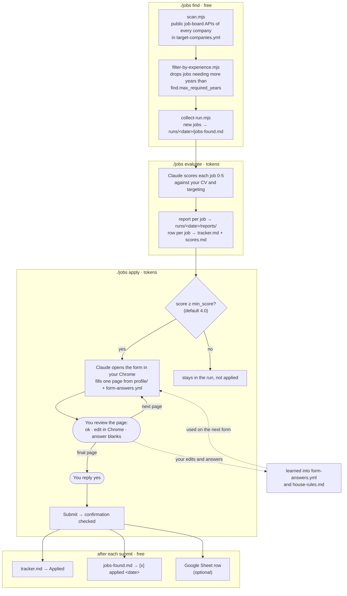
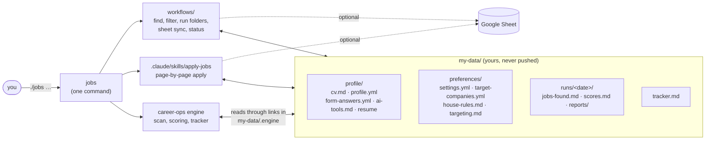

# job-hunter

Find jobs, score them against your CV, and fill applications in your own
browser, one page at a time. You review every page and say "yes" before
anything is submitted. Built on [career-ops](https://github.com/career-ops-hq/career-ops)
(the "engine": scanning, scoring, tracker), with a simpler layer on top.

## The loop

```
./jobs find       scan company job boards → my-data/runs/<date>/jobs-found.md
./jobs evaluate   score each new job (0-5) → scores.md + reports/
./jobs apply      fill applications for jobs scoring ≥ 4.0, page by page
./jobs status     what's found / scored / applied / waiting
```

Every submitted application is ticked in its run folder, recorded in the
tracker, and (optional) added to a Google Sheet.

## How it works

### The workflow, step by step



### Where the pieces live



The engine expects its own file names (`portals.yml`, `modes/_custom.md`, …).
`my-data/.engine/` holds links from those names to your readable files, so you
only ever edit `my-data/profile/` and `my-data/preferences/`. `./jobs` keeps
the links working.

## What's free and what uses tokens

"Free" means plain scripts on your machine: no AI model, nothing billed.
"Tokens" means Claude does the work, which counts against your Claude plan or API usage.

| Step | Cost | What runs |
|---|---|---|
| `./jobs setup` | Free | copies templates, installs dependencies |
| `./jobs onboard` | **Tokens** (once) | Claude asks about you and writes your CV/profile |
| `./jobs find` | Free | calls companies' public job-board APIs (Greenhouse, Ashby, Lever, …), filters by title, location, age and years |
| `./jobs evaluate` | **Tokens** (per job) | Claude reads each posting and scores it against your CV |
| `./jobs apply` | **Tokens** (per application) | Claude fills the form in your Chrome, page by page |
| `./jobs status` | Free | reads your tracker and run folders |
| `./jobs sheet` / `sheet push` | Free | builds sheet rows and sends them to your Apps Script |
| `./jobs doctor` | Free | checks links and setup |
| `./jobs schedule install` (daily) | Free scan + **small** token use | `find`, then a short title-only triage by Claude into `shortlist.md` |

To keep token use down, run `find` as often as you like (it's free), then
`evaluate` only what looks worth it. Scores below `apply.min_score` (default
4.0) never reach `apply`.

## Choosing what to scan

**Which companies:** `my-data/preferences/target-companies.yml`, under
`tracked_companies:`. Each entry is one company's job board:

```yaml
  - name: Stripe
    careers_url: https://job-boards.greenhouse.io/stripe
    api: https://boards-api.greenhouse.io/v1/boards/stripe/jobs
    enabled: true        # false = skip it without deleting it
```

The same file also sets which titles count (`title_filter`), where
(`location_filter`) and how old a posting may be (`max_posting_age_days`).
Experience is set in `my-data/preferences/settings.yml` (`find.max_required_years`).
Or just ask Claude: "add Figma", "turn off Salesforce", "only the last 14 days".

`search_queries:` in that file are web searches for companies *not* on your
list. They're used only by `/career-ops scan` inside Claude (tokens), not by
the free `./jobs find`.

**Which dates, for one scan:**

```bash
./jobs find --since 7                                   # posted in the last 7 days
./jobs find --posted-after 2026-11-01                   # posted after a date
./jobs find --posted-after 2026-10-01 --posted-before 2026-11-30
./jobs find --company Stripe                            # one company
./jobs find --dry-run                                   # preview, save nothing
```

## Setup (about 10 minutes)

Needs: Node.js 20+, [Claude Code](https://claude.com/claude-code), and the
[Claude in Chrome](https://claude.ai/chrome) extension for applying.

```bash
git clone <this repo> job-hunter && cd job-hunter
./jobs setup        # installs dependencies, creates my-data/
./jobs onboard      # Claude Code asks about your CV, targets and companies
```

Then put your resume PDF in `my-data/profile/` and set its name in
`my-data/preferences/settings.yml` (`apply.resume_pdf`).

Optional:
- **Google Sheet:** leave `tracking_sheet.url` empty. The first `./jobs apply`
  asks for a Drive folder link and creates the sheet. See [workflows/sheet/README.md](workflows/sheet/README.md).
- **Daily scan:** `./jobs schedule install` runs `find` plus a quick title
  triage every weekday at 8:00 (macOS). The triage lands in `my-data/shortlist.md`.

## Where things are

```
jobs                  the one command
workflows/            find, filter, run folders, sheet sync, daily schedule
.claude/skills/apply-jobs/   the page-by-page apply assistant
my-data.example/      template for your data folder
my-data/              YOUR data, gitignored (see my-data.example/README.md)
  profile/            cv.md, profile.yml, form-answers.yml, ai-tools.md, resume
  preferences/        settings.yml, target-companies.yml (companies to scan),
                      house-rules.md, …
  runs/<date>/        jobs-found.md, scores.md, reports/
  tracker.md          every job you've scored or applied to
everything else       the career-ops engine (see ENGINE.md), used as-is
```

`jobs-found.md` uses one line per job:

```
- [ ] Company — Role | Location | posted 2026-11-12 | yrs 2+ | score 4.2 | <url>
- [x] … — applied 2026-11-24
- [!] … — skipped: requires 4+ yrs
```

## How it learns

When you fix something on a form in Chrome, or answer a question it couldn't,
it saves the answer to `my-data/profile/form-answers.yml` (facts such as work
authorization or EEO) or `my-data/preferences/house-rules.md` (rules such as
"skip jobs that need 4+ years"). The next form uses them automatically.

## Safety

- Nothing is submitted without your explicit "yes" for that application.
- It never logs in, creates accounts, enters passwords, or solves CAPTCHAs or
  email verification codes. You do those.
- Job postings are treated as data, never as instructions.
- Your data stays in `my-data/`, which is never committed.

## License

MIT, same as career-ops. See [LICENSE](LICENSE).
