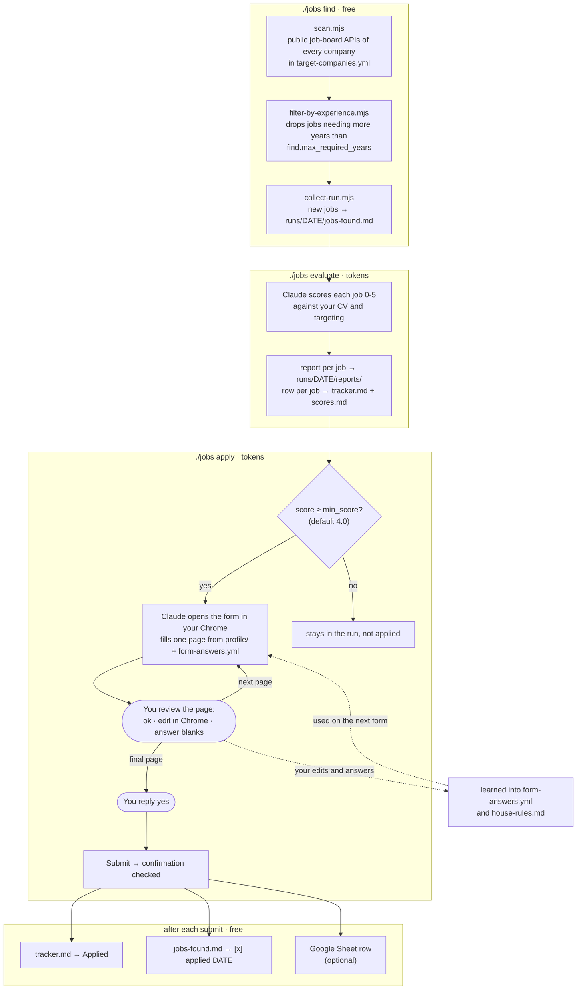
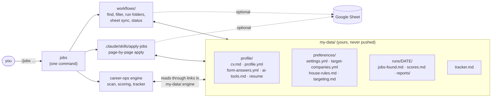

# workflows/: how job-hunter works inside

The short version is in the [main README](../README.md). This page has the full
flow, what each script does, and where every file goes.

## The scripts

| Script | Run by | What it does |
|---|---|---|
| `find-jobs.sh` | `./jobs find` | engine scan → `filter-by-experience.mjs` → `collect-run.mjs` |
| `filter-by-experience.mjs` | find | drops new jobs whose stated minimum years > `find.max_required_years` |
| `collect-run.mjs` | find, evaluate, apply | files new jobs into `runs/DATE/`, copies new reports in, re-syncs every run's checkboxes and `scores.md` from the tracker |
| `link-engine.mjs` | every `./jobs` command | builds and repairs `my-data/.engine` (the engine's view of your files) |
| `status.mjs` | `./jobs status` | one-screen summary |
| `sync-sheet.mjs` | `./jobs sheet [push]` | rows for the Google Sheet; `--push` sends them to the Apps Script |
| `daily.sh` | `./jobs schedule install` | weekday find + title-only triage into `shortlist.md` |
| `sheet/Code.gs` | your Google Sheet | Apps Script that receives rows (see [sheet/README.md](sheet/README.md)) |
| `lib/paths.mjs` | all | every path in one place |
| `lib/runs.mjs` | all | run-folder format: read, write, sync with the tracker |

## The workflow, step by step

## Where the pieces live

The engine expects its own file names (`portals.yml`, `modes/_custom.md`, …).
`my-data/.engine/` holds links from those names to your readable files, so you
only ever edit `my-data/profile/` and `my-data/preferences/`. `./jobs` keeps
the links working.
